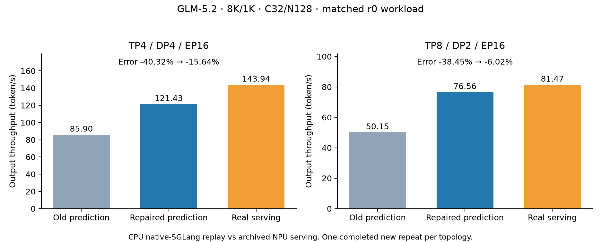

# GLM-5.2算子预测修复证据

Prefill默认SUM_LEN路径每层执行1次gather、2次scatter，清零全局buffer一次、局部buffer两次。Attention TP1采用1次gather、1次scatter。EP1覆盖78层，EP16覆盖3个Dense前缀层，当前范围为DCP1。

独立测量覆盖3个role、19种token规模，共57个合格点。copy使用r1完整曲线。r1的两个小规模清零点未通过CV门槛，因此整条清零曲线使用r2重采结果。原始样本和未通过记录均保留在归档中。

GLM-5.2、Attention TP2/DP8、MoE TP16/EP1、每DP 1024 token的新增分项合计17.967928ms，历史模型内kernel合计20.585900ms，分项残差−12.72%。独立Event与模型内kernel保留各自计时边界，整轮吞吐尚待验证。

`measured-source/`保存实际采集时的源码。发布后的代码经过格式化，历史源码哈希沿用采集记录。`verify_dp_evidence.py`核对冻结源码、重做原始样本资格检查，并逐行比对已发布的57行。

在项目Python环境执行以下命令。

```sh
PYTHONPATH=python/aisimulate python benchmarks/evidence/ascend910c-operator-repair-20261107/verify_dp_evidence.py
```

本轮58项相关单测通过。通信曲线接入后的两套冻结引擎回归共390项通过，耗时353.43秒。

## EP16通信与正式r0验收

`ep-pair-evidence-20261108.tar.gz`包含7个token规模、16rank的112份原始kernel CSV、冻结采集器与资格检查脚本，以及完整数值检查和跳过回放负例。14行稳态通信数据已替换进现有表，列结构和查找键沿用原定义。

每个Graph包含75组Dispatch→Combine。观察到第1组额外波动后，将它单独归属，用第2～75组拟合稳态曲线。原始75组未通过CV的报告也保留在包中。模型内专家到达等待尚需结合依赖建模。

```sh
python benchmarks/evidence/ascend910c-operator-repair-20261107/verify_ep_pair_evidence.py
```

校验器重新计算112份CSV的阶段区间，核对14行导出值、源哈希和数值检查。Python3.9与3.11对一个CV值存在一ULP差异，仅该字段允许浮点末位容差。

| 正式r0 | 旧预测 token/s | 修后预测 token/s | 实测 token/s | 修后误差 |
| --- | ---: | ---: | ---: | ---: |
| TP4/DP4/EP16 | 85.899 | 121.431 | 143.942 | −15.64% |
| TP8/DP2/EP16 | 50.146 | 76.564 | 81.470 | −6.02% |

两组各完成128/128请求，8K/1K、C32，每DP KV32768，与归档实测的语料和调度条件核对。成本表使用0.5.22运行时，Serving源码为native76。每组3轮新回放均已完成，六组逐轮吞吐误差全部低于20%。三轮中位误差为−15.64%与−6.11%，TP4的TPOT中位数仍偏高27.30%。

[正式结果与来源哈希](glm-ep-formal-comparison-r0.json)保存输出吞吐、TTFT、TPOT和实际预测器身份。首轮CPU包装器在隔离模式下选中了旧包，保留为`glm-E4-control-old-predictor-r0.json`基线控制。修正版的正式结果已经核验新模块与二进制SHA。



[三轮完整结果](glm-ep-formal-comparison-three-repeats.json)逐轮核验语料哈希、请求数和预测器身份。合并Qwen适配后390项冻结回归与84项相关测试通过。
