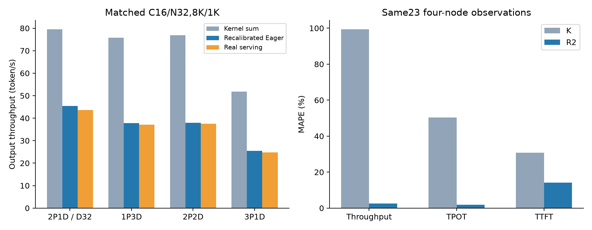
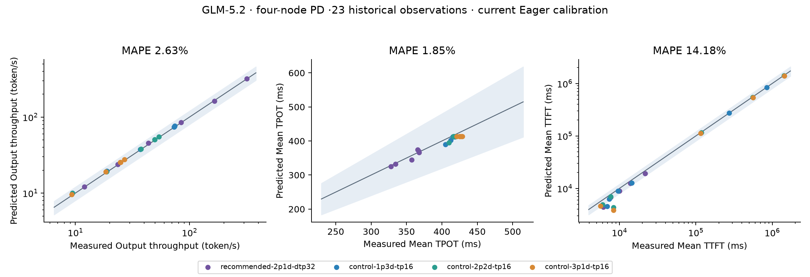
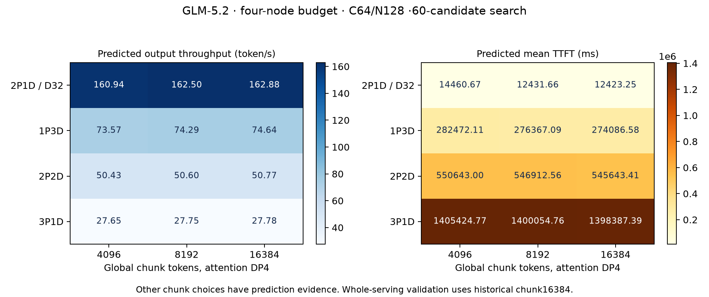

# GLM 四节点 PD 误差校准与 chunk 搜索

2026年11月8日，在本机 CPU 上复用归档实测验证 GLM-5.2 ModelSlim W8A8 的 PD 预测，并将 chunked_prefill_size 接入统一搜索。四节点23条观测的输出吞吐 MAPE 从当前纯 kernel 模式的99.36%降至2.63%，最差绝对误差6.54%。本轮更改包括独立 forward 残差重算和搜索配置贯通，沿用已有 Rust 估时公式。

## 验证条件与数据来源

- 模型为78层 GLM-5.2 ModelSlim 检查点，75层 MoE，256个路由专家、top-8。使用既有模型元数据与逐模块量化描述。
- 实测运行时为910C、SGLang0.5.22、Eager，关闭调度 overlap 与投机解码，保留 shared-expert overlap。KV page128。
- 归档含39条观测、31种唯一负载，其中四节点23条、两节点16条。四节点主要为8192输入、1024输出，客户端并发及总请求数逐条匹配。
- 四节点布局覆盖1P3D、2P2D、3P1D，以及2P1D且D横跨两节点。每节点16个逻辑 device。
- P为Attention TP4/DP4、EP16。普通D相同，跨节点D为TP1/DP32、EP32。这里TP表示Attention组内切分，TP乘DP分别为16和32。
- 固定归档的角色KV容量，P135页、普通D253页、跨节点D968页。采用各角色实测最小容量，副本间1页差异保留为近似。
- 使用 measured KV transfer、full_prompt、replica_round_robin、sglang_gateway 和归档客户端准备参数。

原始历史预测来源提交为6a8f3afa55b5e24a80352e8ed7e474acb0a6ab94。历史归档 SHA256 为3cf9767854f5436168aea80df599128ab834c80fcd405388c7caa51791f2961d，377个成员逐项验证。归档保存实测摘要、测量文件哈希、配置与历史预测。原始远端请求日志本轮未重新获取。详见[历史对照](../../../md/910c-glm52-2node-4node-rerun-20261104.md)。

本轮运行环境为Windows本机Docker，4 CPU、5 GiB，设备请求为空。原生引擎schema36，SHA256为d8159f8c71b063a41cf1a9c12890c2158811de3e2d3b79da342470ec705f3e1d。CPU只执行预测与搜索，真实值来自上述归档。

## 偏差定位与本轮修改

调用链为公开 recommend 配置 → 角色搜索域 → 候选并行和调度参数 → prediction 配置 → canonical Rust FPM → PD Replay中的P排队和Prefill → KV传输 → D逐轮Decode → 客户端统计。

主要源码位置如下。

| 环节 | 文件 |
| --- | --- |
| 搜索配置与整数候选域 | python/aisimulate/src/aisimulate/config/engine.py、recommend.py |
| 候选展开与角色参数传递 | python/aisimulate/src/aisimulate/sweeper/config.py、search_space.py |
| Eager校准口径与拓扑校验 | crates/core/src/perfmodel/fpm/estimator.rs、config.rs |
| 每轮残差计算 | crates/core/src/perfmodel/operators/ascend_eager_overhead.rs |
| 全局chunk按DP归一化 | crates/core/src/engine/scheduler/rank.rs |
| PD事件与传输 | crates/core/src/replay/disagg.rs、engine.rs |

### Eager Decode 的整轮残差

K模式累加独立 kernel。四节点下其TPOT低估约50%，输出吞吐高估约99%。运行时层计时L已能将吞吐MAPE压至7.60%，但只有20/23条得到支持。这将主要吞吐偏差定位到Decode forward的计时覆盖。

旧 Eager profile 早于显式序列长度传输，缺少当前 operator_contract。当前引擎正确拒绝旧参数。将旧数值换个版本标签会重复计时，因此按当前canonical FPM重算每个独立实测forward。

对每轮先计算 residual = measured_forward − current_operator_prediction。使用C1的残差中位数作为base，再用预先指定的多活跃rank训练场景计算斜率。已有Rust公式为

~~~text
非空 Decode forward
  = 当前独立算子估值
  + base_ms
  + (本轮活跃 Attention rank 数 − 1) × per_extra_active_rank_ms
~~~

活跃rank指本轮有Decode请求的Attention DP rank。它由模拟调度结果逐轮生成。整轮残差只加一次，空batch成本为0。

| Decode拓扑 | base ms | 每多一个活跃rank ms | 基准训练 | 斜率训练 |
| --- | ---: | ---: | --- | --- |
| TP4/DP4/EP16 | 186.331215 | 8.891159 | C1，162轮 | C4，160轮 |
| TP1/DP32/EP32 | 128.737999 | 1.497163 | C1，162轮 | C8，160轮 |

目标PD Serving的TTFT、TPOT和吞吐均未进入参数计算。历史文件名中的validation-c4或validation-c8在本轮明确划入训练集。其他独立场景留出验证，TP4/DP4留出forward MAPE约3.79%至6.93%，TP1/DP32约1.45%至5.55%。完整逐轮结果和训练标识保存在[校准数据](results/runtime-v2-calibration.json.gz)。

这些残差合并了host提交、stream空闲与可能的算子漏项，各分量仍待细分。校准绑定GLM-5.2、SGLang0.5.22、Eager和对应拓扑。Prefill残差保持0，其估值继续来自算子表和既有专家先验。

### chunk 搜索贯通

原接口只允许固定chunk。现在支持固定值、choices、线性整数range和log range，并沿角色搜索域、采样、runner、候选保存贯通。省略值保留默认行为。

~~~yaml
engine:
  workers:
    prefill:
      scheduler:
        chunked_prefill_size:
          choices: [4096, 8192, 16384]
~~~

该值是全局token预算。P的Attention DP4对应每rank1024、2048、4096 token。候选YAML保存全局值，Rust构造rank时除DP一次。

## 相同历史观测的误差

误差为100 × (预测/实测 − 1)，MAPE为逐条绝对误差均值。吞吐统一为输出token/s。

| 四节点模式 | 覆盖 | 吞吐MAPE | TPOT MAPE | TTFT MAPE |
| --- | ---: | ---: | ---: | ---: |
| K 独立kernel | 23/23 | 99.36% | 50.28% | 30.78% |
| L 实测层组合 | 20/23 | 7.60% | 8.90% | 18.17% |
| R2 算子加新Eager残差 | 23/23 | **2.63%** | **1.85%** | **14.18%** |

R2四节点吞吐误差范围−1.82%至+6.54%，23条全部低于20%。L的3条失败来自跨节点D的SUM_LEN padding bucket缺测，保持覆盖检查。

两节点16条中，R2吞吐MAPE4.65%、TPOT2.68%、TTFT19.72%。L分别为2.15%、4.37%、25.20%。全部39条的R2吞吐MAPE3.46%，最差9.98%。保留L和R2的各自结果，便于按用途选择。

四节点有6组相同负载的拓扑排序对照，R2的第一名6/6与实测一致。旧K也已6/6，不能把这项计作新增收益。完整次序及Spearman保存在[逐条结果](results/pd-validation.json)。

TTFT仍有大偏差。3P1D C4低估54.30%，2P2D C4低估约48.1%。冷分配、编译、首次非空文本与稳态运行时残差的贡献尚未逐项分离，TTFT尚未全面达到20%目标。

## PD 与 chunk 联合搜索

为保持校准拓扑一致，使用两组独立配置。每组精确使用64个device，预算为四节点，目标仅为输出吞吐。

| 配置 | 拓扑范围 | chunk | 并发 | 完成候选 |
| --- | --- | --- | --- | ---: |
| pd-chunk-search.yaml | 1P3D、2P2D、3P1D，普通D | 4096、8192、16384 | 4、8、16、32、64 | 45/45 |
| pd-chunk-search-wide-decode.yaml | 2P1D，D跨两节点 | 相同 | 相同 | 15/15 |

总请求数为并发的2倍。60个唯一候选全部完成，无失败、超时或覆盖拒绝。两组搜索各自第一名用普通predict重跑，吞吐、TTFT、TPOT完全一致。跨节点D第一名还通过当前工作区的普通CLI复算，128/128完成。

合并60个候选后的预测第一名为2P1D，D跨两节点，global chunk16384、C64/N128。预测162.883 token/s，相同历史配置实测165.899 token/s，误差−1.82%。这次按吞吐目标选择，未加入TTFT/TPOT SLA约束。

探索阶段chunk32768的15个候选全部因DeepEP sent_tokens=2048超出实测区间1至1024而失败，原始失败记录保留。合格域限定到16384。历史整机实测只覆盖chunk16384，其他chunk的验证覆盖候选传递、算子数据范围与完整回放，实际Serving排序仍需新实验。

## 本机运行与复算

容器aisimulate-cpu-local-20261107挂载仓库为/workspace。以下命令使用当前源码和已核验Linux缓存。新输出目录须与已有目录区分。

~~~powershell
& 'D:\code\学习\实验\aisimulate-local-cpu-20261107\Run-AISimulate.ps1' recommend -c /workspace/benchmarks/evidence/ascend910c-pd-chunk-20261108/configs/pd-chunk-search.yaml --output-dir /runtime/pd-chunk-local-new
& 'D:\code\学习\实验\aisimulate-local-cpu-20261107\Run-AISimulate.ps1' recommend -c /workspace/benchmarks/evidence/ascend910c-pd-chunk-20261108/configs/pd-chunk-search-wide-decode.yaml --output-dir /runtime/pd-chunk-wide-new
& 'D:\code\学习\实验\aisimulate-local-cpu-20261107\Run-AISimulate.ps1' predict -c /workspace/benchmarks/evidence/ascend910c-pd-chunk-20261108/configs/top1-wide.yaml --output-dir /runtime/pd-top1-new --format json
~~~

其他机器需构建包含本轮Python改动和对应native的运行环境，将配置中的engine.model和engine.systems_paths改为其实际路径。模型目录只需配置和量化元数据，性能表需保持相同版本。

evidence.tar.xz包括377成员历史输入的原归档、独立forward源数据、62次K/L与31次R2回放、两组正式搜索、探索失败、top1复算、配置和本轮相关源码快照。成员哈希及原生引擎指纹见[manifest.json](manifest.json)。运行python verify_evidence.py可校验归档SHA和668个成员，再解压到/opt/pd-chunk-20261108。分析过程可依次执行同目录脚本。

~~~text
prepare_historical.py
prepare_runtime_profiles.py
recalibrate_runtime_v2.py
run_historical.py --campaign new-baseline --all
run_historical.py --campaign new-runtime --all --prepared runtime-v2-prepared.json
prepare_joint_search.py
prepare_joint_search.py --wide-decode
~~~

报告脚本当前读取冻结campaign名baseline-all及runtime-v2-all。若使用new-*目录重新跑，需相应更换report_pd_validation.py中的输入目录后生成新报告。

## 验证与仍需补充的实验

- 搜索配置贯通单测26项通过，Sweeper相关回归354项通过。
- Ascend Rust相关单测85项、HCCL6项通过。稀疏checkout省略的两份已跟踪oracle现已恢复，既有HCCL测试断言改为读取查询结果的latency字段。
- 冻结engine/compile parity390项通过。
- 31种唯一负载的R2回放全量成功，对应39条归档观测。普通CLI复算与冻结运行时结果一致。
- 后续实验集中在低并发TTFT分项、多种chunk的真实四节点Serving对照，以及残差的host、stream与算子漏项细分。
