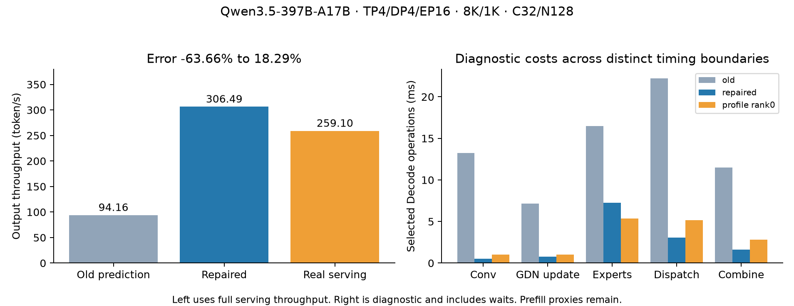
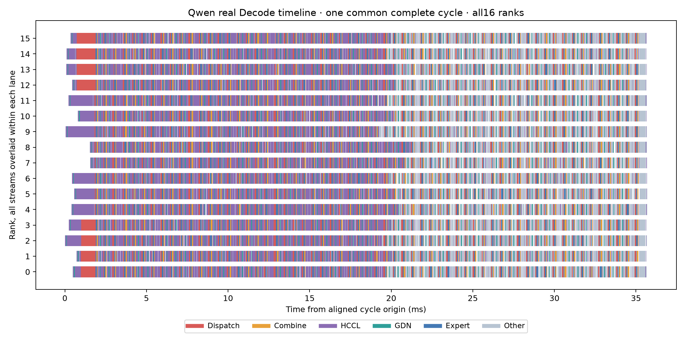

# Qwen3.5-397B-A17B预测修复

当前验证为单机16个Ascend910C逻辑设备、Attention TP4/DP4、MoE EP16、ModelSlim混合精度、Graph Decode和FP32 GDN状态。每请求8192输入、1024输出，C32/N128，每DP KV32768，page128，全局chunk8192经DP4拆为2048，关闭MTP、Prefix Cache和Overlap Scheduler。

| 指标 | 旧预测 | 修后预测 | 实测 | 修后误差 |
| --- | ---: | ---: | ---: | ---: |
| 输出吞吐 token/s | 94.163 | 306.486 | 259.099 | +18.29% |
| TTFT p50 ms | 255499.359 | 79750.672 | 95885.366 | −16.83% |
| TPOT p50 ms | 120.791 | 34.892 | 38.278 | −8.84% |

新旧CPU回放和本轮真实服务均完成128/128。CPU处理负载形状与调度边界，专家路由采用balanced估计。真实请求语料SHA保存在报告和原始包中。CPU回放使用仓库内置SGLang行为模型，GLM对照另采用native76原生调度。

## 主要原因与修改

| 项目 | 历史估值问题 | 当前处理 |
| --- | --- | --- |
| Conv | 采集包装器与当前NPU Backend实际调用不同 | 使用当前`torch.ops.npu.causal_conv1d`入口和Graph |
| GDN | 实现、状态精度及KV/VK布局存在差异 | 使用运行时绑定的NPU专用入口，校验FP32状态 |
| 专家计算 | cap128对应20480物理行，当前cap16对应2560行 | 按真实buffer和TP4散射重建，独立测试平均10个专家分配 |
| Dispatch/Combine | 历史独立调用边界、token轴和实际连续Graph不同 | 60对连续Graph，3轮预热、10轮计时，取第2～60对稳态区间 |
| TP通信 | 历史Attention AllReduce路径缺少Decode FFN AllGather | 使用60次ReduceScatter、61次AllGather及独立Graph测量 |

固定每DP3请求的Decode查询从119.150790降到33.252116ms。模型内选定rank0的设备跨度为35.171317ms。单算子、设备跨度和完整请求各自保留计时边界。

实际运行时为镜像`sha256:ed48c44e8da49820e3f935d38a8cdb623e184b27361afdf2d1e6e3ecd4e741e0`，SGLang提交`a6b542813ff46de8ba3856e0236f1af35f4fca54`，torch_npu2.10.0，CANN9.0，DeepEP1.0.0+d9261669.cann.9.0.0.b250。相关调用位于`hardware_backend/npu/attention/ascend_gdn_backend.py`、`layers/attention/linear/kernels/gdn_triton.py`和`models/qwen2_moe.py`。

## 独立证据

35行Qwen自定义成本、18行Linear和3行HCCL已放入`systems/`。历史Prefill和其他拓扑的旧数据保留各自执行合约。所有数据沿用原表结构。

`qwen-graph-evidence-complete-20261108.tar.gz`为8033813字节，SHA256为`70540229f9c0dc3a1532759392fdf385f85ad86161ae5b51deac6dca5d48a16d`。其中包含独立采样源码、数值检查、原始样本、通信CSV、稳定时间线、真实128请求记录与语料。

```sh
python benchmarks/evidence/ascend910c-qwen35-graph-20261108/verify_evidence.py
```

校验153个原始文件哈希，并重算16份CSV的10轮Dispatch/Combine成本。独立通信的首对边界沿用GLM阶段已建立的划分，完整原始样本随包保留。





[逐项预测与指标](qwen-graph-formal-comparison.json)包含误差和范围。[原始事件](qwen-decode-chrome-trace.json)可以在时间线工具中逐stream展开。图中跨stream存在重叠和等待。

## 本机CPU复现

当前Docker环境把仓库挂载到`/workspace`，模型元数据位于`/runtime/qwen-model`，成本数据已缓存到Linux文件系统的`/opt/qwen-graph-systems`。这两个目录分别对应本目录的`model-metadata/`和`systems/`。换环境时将YAML中的两处路径指向其副本。Windows共享盘上的成本表读取出现长时间文件系统等待，本机复现使用已核验的Linux缓存。

```sh
PYTHONPATH=/workspace/python/aisimulate/src aisimulate predict \
  -c /workspace/benchmarks/evidence/ascend910c-qwen35-graph-20261108/qwen-graph.yaml \
  --output-dir /tmp/qwen-graph-validation --format json
```

`qwen-graph.yaml`保持固定1024输出所需的`ignore_eos=true`，与真实benchmark一致。历史失败回放遗漏此设置，KV预留策略触发了未认证的多请求Prefill限制。保留该限制后，补齐匹配配置已完成完整回放。

当前范围为TP4/DP4/EP16、每DP1～4个真实Decode请求。Prefill与embedding、GQA prepare/cache/attention/gate、logits finalize六个小项保留历史成本。更大批次、其他Graph拓扑、真实路由不均衡和FP32 Prefill仍需独立验证。Eager整模型预热异常尚待定位。吞吐达到20%目标适用于本表条件。

精度metadata来自实际测量权重的配置和ModelSlim描述，随包保留来源哈希。包含的配置仅用于纯文本decoder建模，视觉与MTP成本另行验证。

## TP2 与 TP8 的本地预测覆盖检查

11月8日通过当前工作区的普通predict入口分别尝试TP2/DP8/EP16与TP8/DP2/EP16，均返回TP4 Graph校准范围错误，退出码1。两组保留8K/1K、C32/N128、global chunk8192及每DP KV32768，按归档设置context10240、每rank最大请求数4或16。结果和具体缺测矩阵见[覆盖报告](topology-coverage-20261108-r1/coverage.json)。

| 配置 | 所需线性层N/K与量化身份 | 当前Graph表已有 | Graph表缺少 | HCCL缺测 |
| --- | ---: | ---: | ---: | --- |
| TP2/DP8/EP16 | 9 | 4 | 5 | 2卡组ReduceScatter、AllGather |
| TP8/DP2/EP16 | 8 | 4 | 4 | 8卡组ReduceScatter、AllGather |

GDN Conv、状态更新与norm gate的Graph数据仅覆盖TP4。另有5类向量角色缺少对应TP身份，其中形状相同的部分需先审查物理签名和token轴，才能复用。表中已有的线性层身份也需进一步检查M轴范围及运行时一致性。EP16的Graph专家与Dispatch/Combine只有1个物理token的合格点，TP2在每DP达到3或4个真实请求时需要2个物理token，现有Rust映射还明确绑定TP4。

CPU预测入口已验证可执行。后续需补齐缺失Graph形状数据及对应token轴适配，再完成两组Serving误差对照。恢复状态保存在本机qwen-graph-onboarding-checkpoint.json的两个配置记录中。

